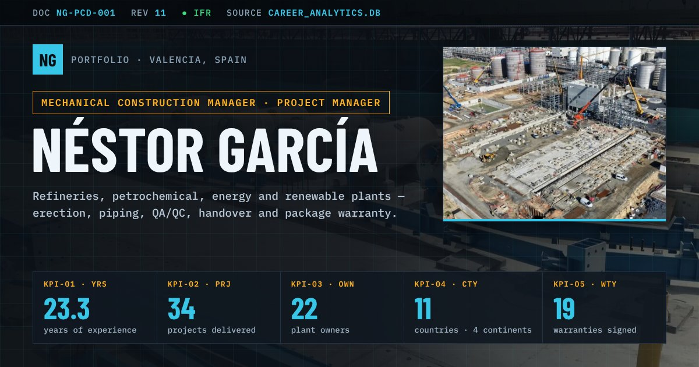

# Néstor García · Portfolio

**Live site:** https://nestorgarcia-mcm.github.io/

Personal portfolio of Néstor García, Mechanical Construction Manager based in Valencia, Spain. It presents 34 projects in refineries, petrochemical, energy and renewable plants, from erection and piping to QA/QC, handover and package warranty.

## What is inside

| Section | Content |
|---|---|
| Profile and KPIs | Career summary and headline figures |
| Projects and case studies | Selected projects and four case studies told slide by slide |
| Career and experience | Timeline, roles and a map of 25 sites |
| Capabilities and standards | Scopes, systems and 109 codes and standards (81 applied in documented projects) |
| Clients | Plant owners, engineering companies and contractors |
| Data and AI | How the figures are produced: project database, Power BI model, document control and AI tools |

The site is available in English, Spanish, French, Portuguese, Italian, Swedish and Norwegian.

## How it is built

- One static `index.html` with plain HTML, CSS and JavaScript. No framework, build step or server.
- Figures come from my own SQLite database of project records and documentation (`career_analytics.db`), queried on 11 November 2026. They describe my own career records and are not independently audited.
- Charts in the data section are redrawn from my documents. No client document is reproduced.
- Images are WebP and load lazily. Publishing uses GitHub Pages or GitLab Pages (`.gitlab-ci.yml`).

To view it locally, open `index.html` in a browser, or run `python -m http.server` in this folder and visit `http://localhost:8000`.

## Rights and credits

- © Néstor García. Text, data and photographs: all rights reserved. Site photographs come from projects where I worked.
- Company names and logos belong to their owners. They appear only to identify the organisations involved in each project.
- Fonts: Barlow Condensed, IBM Plex Sans and IBM Plex Mono (SIL Open Font License), served by Google Fonts.

## Contact

[LinkedIn](https://www.linkedin.com/in/ngarcia-mechanical-construction-manager/)
